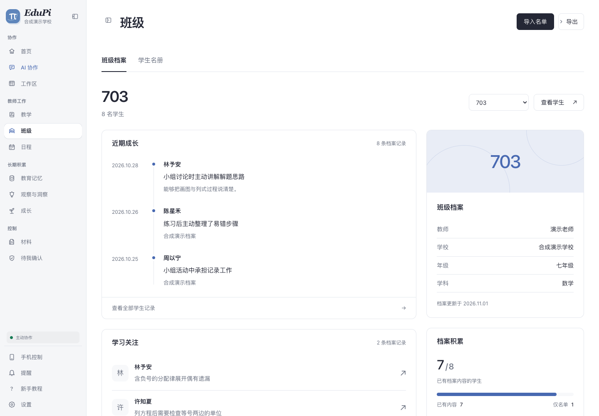
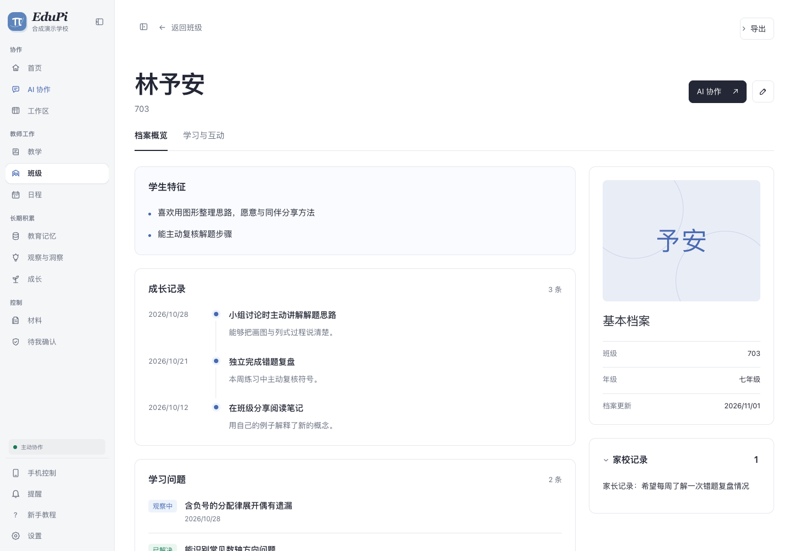

# 班级与学生档案

R12／R17 的本次界面增量已完成开发验收，代码提交 `609150cc4c7f0287e232cdeb5c27fb94ef02e38b`，分支 `codex/class-dossier-redesign-20261031`。用户要求按档案／简历参考图大改整个班级入口，点击学生后使用完整主内容区；此次不改已发布 `.94` 的资产，不执行安装或操作正常 EduPi，更新核验留给用户。

## 页面

- 班级默认进入班级档案：班级范围、名单人数、近期成长、学习关注、基本资料与档案积累。名册单独切换；全部、具体班级与未分班使用相同成员规则。
- 学生打开为完整档案页，取代右侧窄抽屉：大姓名、基本档案、特征、成长时间线、学习问题、家校记录、相关记忆和宽版历史快照。学习／互动、家校人物和网络图保留在记录页。
- 主内容正文采用 14–15px、姓名 32–44px；历史快照 14px，完整换行。页面使用原有主题色、轻边界和短进入动画，支持暗色与减少动态效果。
- 只展示已有名单字段与既有记录，不填造照片、年龄、成绩、能力分或好友关系。班级聚合的成长／问题数量来自当前名单档案，不冒充全部事件数量；全体事件入口明确标注全部学生记录。

## 实际验证

环境为 macOS arm64、Node 22.23.1、Next 16.4.3，独立 Chrome 上下文访问隔离开发端口 `127.0.0.1:30144`，阻止 Service Worker；所有 API 使用拦截的合成资料，不向真实学生根写入。浏览器交互和数值观测见[逐项记录](assets/2026-11-01-class-dossier/observations.json)，静态与回归结果见[验证摘要](assets/2026-11-01-class-dossier/verification.json)。

| 操作／预期 | 实际结果 |
| --- | --- |
| 切具体班级和未分班，点击学生，返回同一范围 | `703` 显示8名合成学生；未分班1名，返回仍保留未分班筛选 |
| 点击学生后内容占满主区 | 1440px窗口的学生档案宽1160px，旧名册行0、对话框0；基本档案与主要动作可见 |
| 从名册下方进入、再返回 | 实际滚动 `477 → 0 → 477`，进入从姓名开始，返回恢复名册位置 |
| 同名跨班 | `synthetic-student-8` 请求携带自身ID，不显示 `synthetic-student-0` 的特征和记忆 |
| 手改取消、保存后重读 | 取消无写请求；保存保持学生ID、时间与revision前置条件，确认后页面及重新载入展示新特征 |
| 历史和键盘 | 宽区可看修改前／后；最终说明14px、时间12px、快照14px；Tab可到手动修改 |
| 记录、范围、图谱和失败 | 列表／网络图可切，展开后Escape关闭；自定日期随学习／互动切换保留；合成503错误显式重试后恢复 |
| 响应式与稀疏内容 | 1440、1024、768、320宽度无横向溢出，长特征换行；空名单仅一个导入入口；暗色可读，减少动态效果时动画为none |

上述保存／重读通过同一隔离浏览器的模拟传输验证界面合同与刷新，不作为新一轮真实 Core 持久化验收。此次没有改写后端存储协议；原编辑／恢复、事件刷新与同名边界仍有定向回归。

定向 `node --test` 覆盖学生UI、身份、事件焦点、分页、档案版本、班级聚合、详情可见性、disclosure与上游提取哨兵，共76通过／0失败／0跳过。`tsc --noEmit`、目标 ESLint、五份样式 PostCSS 解析和 `git diff --check` 通过。独立只读审查发现未分班返回、列表滚动恢复、带空格班名筛选三个问题，均修补并有回归；最终无剩余确定 P1–P2。初始浏览器夹具缺少memory.tags和sessions响应包装，修正夹具后重跑；工具超时的浏览器上下文已关闭并重新建立，未把失败初始化计为通过。

## 清理与边界

浏览器、开发服务已关闭；端口30144无监听，`.next`和本轮隔离临时根无句柄、无Git跟踪后精确清理。原分配 `405184 KiB`，同卷可用量实测增加 `405184 KiB`；源码、截图、验证记录和在用依赖保留。[清理回执](assets/2026-11-01-class-dossier/cleanup.json)。

未构建新安装包，未更改公开 Release 或自动更新源，未执行原生 App、真实 Core 写入／恢复和自动升级验收。本记录只确认开发版的本次界面与导航增量，不能将 R12／R17 的其他验收项勾为完成。
