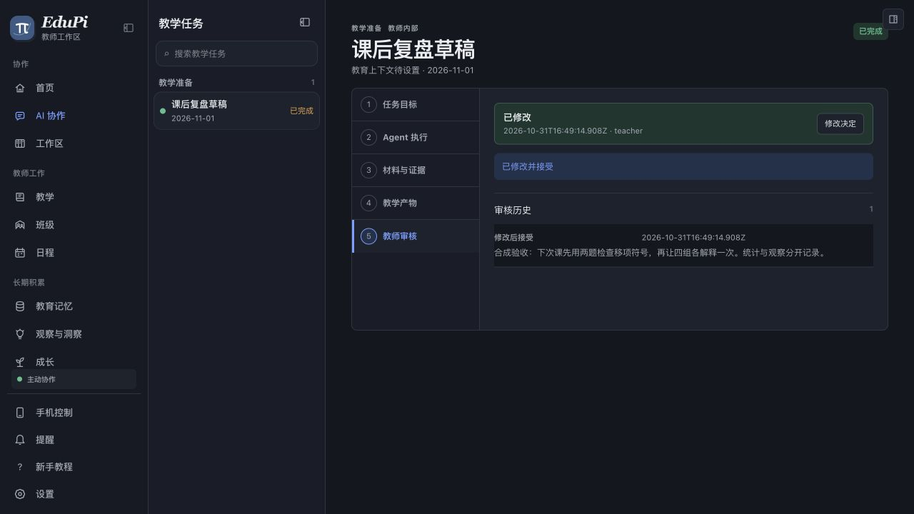
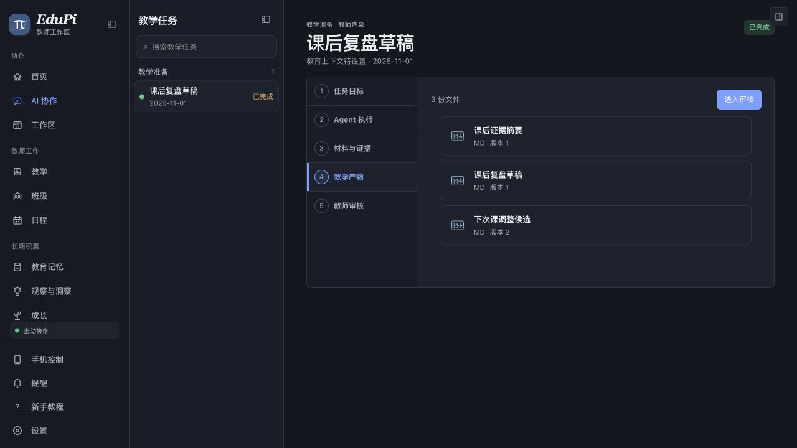

# macOS L4 内置浏览器验收记录

2026-11-01。仅使用合成数据、Loopback Core 和 Codex 隐藏内置浏览器；没有操作正在运行的正常 EduPi、真实教师资料、系统睡眠或公开更新源。该记录沿用 [R03／R04／G1–G6 任务账本](../plans/2026-09-06-product-closure-roadmap.md)。

## 固定版本与浏览器流程

| 对象 | 精确身份 |
| --- | --- |
| 签名候选 | 0.3.95 Draft 的 [Mac-only run 41174329943](https://github.com/PIGU-PPPgu/edupi-desktop/actions/runs/41174329943)，Desktop `3edfff1d3706213b36638594e504aea5d9ce4e3f`，包内 Core `2a0016a4f9499c97e705fd8d4b28acdbc49d2d91` |
| 浏览器宿主 | 同一签名更新包中解压的 `server/desktop-server.cjs` 与签名 Node helper；仅监听 `127.0.0.1:30145`，数据根 `~/edupi-route1-canary-095-g4-3f7855c1e307` |
| 真实安装版 | `/Applications/EduPi.app` 仍为 0.3.94 且在运行；未安装、替换或启动第二个 App |

Core 隔离种子先产生一个 G4 `draft_ready` 任务、3 份内部产物及 `external_send=false`。包内服务器的 `/api/edupi/status` 返回 `core=ready`、精确 Core pin、任务 1。隐藏内置浏览器从首页打开“课后复盘草稿”，查看下次课调整版本 1；在“教师审核”输入合成调整并点击“修改后接受”。实际页面显示“已完成”和审核历史 1 条；从产物页打开版本 2，正文包含刚输入的调整。Core 状态文件中旧调整版本 1 为 `stale`、版本 2 为 `current`，同一 `work_case_id` 未变。

随后仅终止该合成根的 Core host PID `26274`，下一次状态请求启动 PID `30852`。状态文件 SHA-256 前后均为 `cbaf6c0ab5a4b3e39cc84f822ada04ebef37fb334732138a21be9c7f88893a69`；浏览器刷新后仍显示“已完成”及调整版本 2。此项证明包内 Web UI、Core 写入和 Core 子进程恢复；没有证明原生 Tauri 启动、系统通知点击、实际睡眠或整机升级回滚。

## 其余非睡眠定向检查

| 领域／门槛 | 实际命令与结果 | 证据边界 |
| --- | --- | --- |
| G1 教学准备 | 固定 Core `cb28c87f` 执行 `node scripts/test_g1_durable_teaching.mjs`，23 个合成场景通过，覆盖崩溃、取消、超时、来源改删、授权收窄、预算和默认关闭；`external_send=false` | 隔离 Core worker；未运行本版原生 G1，也未做真实 OS 睡眠 |
| G2 学生跟进 | 同 Core 执行 `node scripts/test_student_followup_natural_intake.mjs`，自然消息、观察隔离、反馈、转班、撤源、重启、预算拒绝通过；4 次合成 provider 调用，0 付费调用、0 自动正式 Fact | Core E2，不是安装版 UI |
| G3／G4／G5 与安全 | Desktop Main `7013618a` 配对 Core `cb28c87f` 执行 `node scripts/test-edupi-capability-canary-e2.mjs --require-recipient-confirmation`，三域各 3 产物、审核与合成反馈回读、跨学生拒绝、收件人确认、危险外发拒绝、停止重启恢复通过；3 次本地合成聊天、0 能力模型调用 | 真实 Pi SDK／Core 子进程，但不是 0.3.95 签名包 UI 的三域自然触发 |
| 来源证明 | 0.3.95 固定 Core 执行 `node scripts/test_owner_recall_source_support.mjs`，撤源、加源、学期变更、授权撤销与 drain 场景通过，0 provider 调用 | 单来源只读证明，不是逐属性回答证明 |
| 教学内容规则 | Core `cb28c87f` 执行 `npm run test:g1-teaching-quality`，124/124 通过 | 规则、数学与来源夹具；不代表广泛课堂质量或独立人工核对 |
| 正式盲测准备 | `npm run test:l4-formal-prep` 通过 60 故事／360 时间点／12 开发槽／120 重复槽；`npm run test:l4-nonpaid-blind` 通过 492 次确定性策略评估 | 两项实际模型调用均为 0；正式语义盲评与真人裁决仍未运行 |

R04 仍有一个可重放的安全缺口：在隔离 Owner HTTP 夹具里，只选一份“花灯班会由张老师主持”的当前来源，询问“谁主持、排在第几场”，注入一个错误地把全文标为 `supported` 的合成模型回执，产品返回 `status=current`、1 份来源。此探针证明**当前代码缺少独立逐属性围栏**，不证明真实 GLM 在这道题上会犯错。直接把所有带连接词的查询拒绝会覆盖 v17 已揭晓 60 题中的 47 题，因此不能当作完成 R04 的正向修复。须建立可信事项身份、每项问题的当前来源锚点，并在新未见样本上测量。

R03 旧版回滚的首次脚本返回失败：旧 Core `00d05a1` 无法读取新版 `gate_anchor`。修正后的[Core PR #423](https://github.com/PIGU-PPPgu/edupi/pull/423) 定向复验要求旧版**拒绝启动并零业务写入**、新版重开、预升级备份供旧版恢复，结果通过；精确 CI 和合并状态另记。这个结果不等于已安装 App 的升级／回滚。

开发模式在两个隔离 localhost 端口出现 Next 客户端 `OuterLayoutRouter` 的 `slots` 错误，页面停在加载态；同一签名包内的生产服务器在内置浏览器成功打开并完成上述 G4 操作。开发模式问题单列，不用它否定已通过的生产包内流程。

## 未验证

- 0.3.95 唯一 macOS App 原生安装、通知点击、升级及回滚、真实资料保持；正常 0.3.94 仍在用，按仓库隔离门不启动第二实例。
- G1–G5 加贯穿安全在**同一签名安装版**的六条自然触发全链；本轮 Core E2、Desktop E2 与 G4 包内浏览器分别记账。
- R04 可信双来源联合证明、单来源逐属性支持和新的未见语义门；正式盲评、广泛教学内容人工核对与真人连续使用价值。
- 真实跨到期系统睡眠，按用户要求后置。
