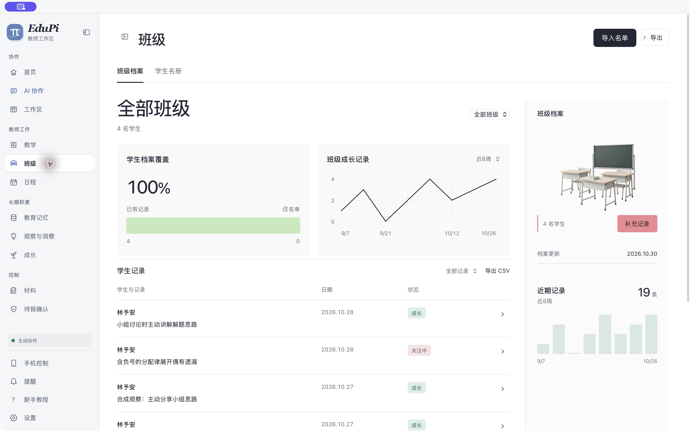
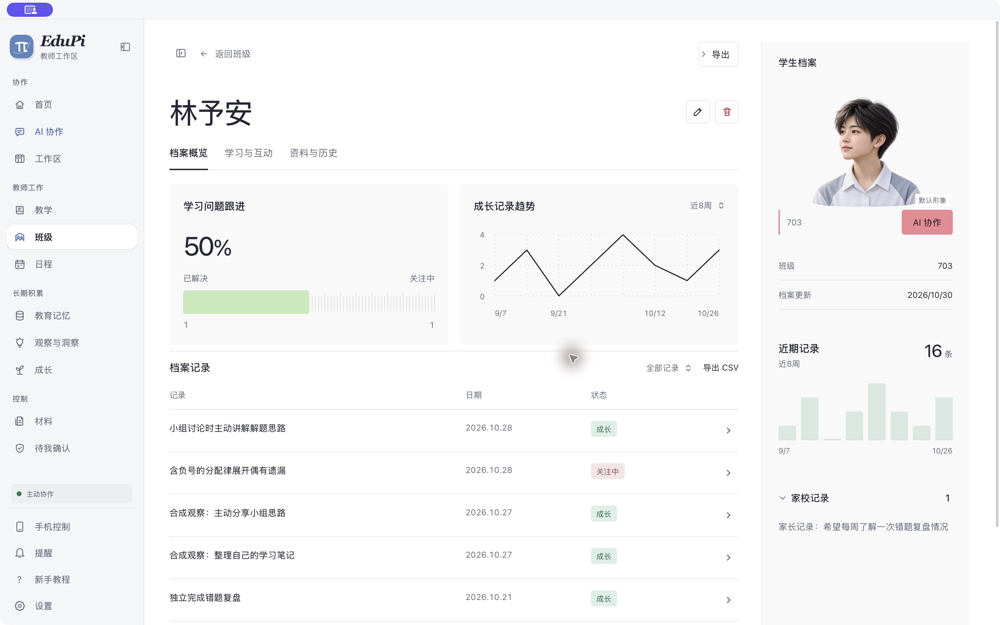

# macOS 0.3.96 档案界面与 Core 配对

## 当前状态

macOS arm64 **0.3.96 已完成签名构建、公证、本机安装和隔离原生验收，并已用正常资料根启动**。班级与学生档案来自本轮受测源码；Core 固定 `56c7ed54cbe65af6b6526eb4f5ac556e9c88e00d`。正常 App 与 Core host 进程已核对，当前 Mac 锁屏使正常窗口的最后一次目视核对不可用，不能记作用户已验收。

[PR446](https://github.com/PIGU-PPPgu/edupi-desktop/pull/446) 的 audit、rust-audit、linux-source 全部成功并普通合 Main `ff97f054e15f5c19da3ffacbf8aa29a575932544`。受测 head `acbd12b07990ec60927493be7975c00081a97189` 与合并 tree 相同。[唯一 Mac-only 签名 run41285449694](https://github.com/PIGU-PPPgu/edupi-desktop/actions/runs/41285449694) attempt 1 成功；Draft release `430428870` 固定该 head。`.96` 仍为 Draft，公开 `v0.3.94` macOS 预发布与 `.70` updater feed 均未切换。此记录沿用 R04、R12、R17，取代此前“正在构建／未安装”的阶段状态。

## 源码范围

- 新班级／学生档案与图表来自已合 PR442，实现 `1b95d923`。
- 应用版本为 .96；Core 固定 `56c7ed54cbe65af6b6526eb4f5ac556e9c88e00d`。
- Desktop 组件清单 `sha256:f1b1e8f961cac81f0e3af256f8832915d9b104233b5669b3f88c41750b5f21ea`，Runtime 清单 `sha256:a3122cfcdeac42d4b7d7e91d94bbb0202ce4be4073c176bb1724538e1131aadc`，Runtime schema `sha256:c0bc52462cf2b42aa63cf8fec23f7fdb3199145ddd8d74e8133d6d58b7a2c5e2`。
- 补齐隔离模型宿主复制所需的 `recall_compound_guard.mjs` 与 `memory_recall_query.mjs`，保留常规文件和逐字节检查。
- G3 Durable 只由 macOS 隔离环境中的精确行政授权开启；G4／G5 和正常环境的既有范围不扩张，G6 为 hold／feedback。
- 普通对话保留 Main 现有注册、持久 outbox 与恢复路径，不整体合旧 #324–329 链，不引入未合 #422。

## Core 检查边界

PR427 head `a414b8e5dde328ccf00afba8957691dd8ecd72c6` 与 Main56c7 的 tree 均为 `3b71abb04d5933715104f2a95f7f0e3df2720bfe`。[PR 精确 Core Quality 41274979051](https://github.com/PIGU-PPPgu/edupi/actions/runs/41274979051) 完整成功。

[Main 复跑 41282473308](https://github.com/PIGU-PPPgu/edupi/actions/runs/41282473308) 失败：G1 loopback flow 在有界等待后仍为 running。该失败保留；同源本机定向 flow 在 20.2 秒通过，不能据此写作 Main CI 已通过。随后 Main 的 heartbeat 测试夹具修复不改变本轮冻结的运行源码。#422 候选的失败也未归入本轮包。

2026-11-01，Core 独立线程报告在当前 `56c7` 来源合同下复现一项新的 R04 风险：显式 `category=class` 配合不完整的 `memory_id`，可能遗漏另一类别当前结构化 CASE 的来源，错误返回 `current`。本构建线程已读取原复现回执 `2026-11-01-r04-cross-category-inventory.json`（SHA-256 `6975cdd8e053d31c83f89cd7b8f853485842480dcf200142ef4b775a5ba6a073`），未独立重跑；其受测 base 为上述精确 Core56c7，隔离 HTTP 使用合成资料且未调用外部模型。修补候选 `14b516b829f43b2ead3818ae017297ef57f4dfa2` 尚未进入本轮签名包，不能将 `.96` 记作已修复。保持已安装包的固定源码与 Draft 状态，公开发布前需单独评估此风险。

## 已执行检查

- .96 版本元数据、Cargo locked metadata 与 release:verify 通过；发布／隔离护栏 54 项通过。
- 精确 Core56c7 的身份、宿主与打包组件检查本机为 42 通过、1 条件跳过；该本机跳过来自没有 staged server。签名 CI 已实际通过 copied host SDK 的隔离 localhost 模型场景，不把本机跳过改写为本机通过。
- 补齐模型宿主复制后，定向 2 通过、1 条件跳过；修正旧抽屉哨兵、本地依赖与公开源检查后，32 项定向通过。
- G3／G4／G5 隔离真实 Core E2 通过：自然请求各生成 3 件内部产物，权限拒绝、审核读回、停止／恢复／冷启去重通过；G3 私有 SQLite quick_check=ok，历史 ID 未重复。使用本地合成对话，能力生成模型调用 0，外发 false。
- 精确 Core56c7 的完整 `EDUPI_CORE_ROOT=... npm test` 为 3538通过／16条件跳过／0失败；不带Core环境为3506通过／48跳过／0失败。类型检查通过，lint退出0并保留一项既有未使用变量警告；安全策略 `npm audit --audit-level=high` 退出0，有17项moderate记录，未降级阈值。

最初完整测试的失败分别来自旧学生抽屉哨兵、本机依赖落后锁文件和一次 Git 枚举缓冲错误；原日志保留。ESLint 还曾扫描正在删除的生成夹具，现仅排除已被 Git 忽略的 `output/design-qa/`，没有排除产品源码。

## 签名与安装证据

同一签名 run 的三个最终资产均按 GitHub asset ID、大小、摘要与生成时间核对，updater 的 Minisign 验证及篡改拒绝通过。App 与 DMG 的严格签名、公证票据、Gatekeeper 检查通过，架构为 arm64，签名 Team ID 为 `BY3XZG2839`。最终 App 公证 ID 为 `79bfd0b2-f149-419b-97d0-23393267e8fa`，DMG 公证 ID 为 `7f87370b-7af2-4d67-9d04-2e9f6fceb1f7`。

| 资产 | Asset ID | SHA-256 |
| --- | --- | --- |
| `EduPi_0.3.96_aarch64.dmg` | 697802263 | `34a7840acfbafa7e1b0f7e740f4b78f62710e016eb20f79ee33380fded800e3e` |
| `EduPi_aarch64.app.tar.gz` | 697802800 | `4eac89fda1adc6cfc625907982574b98d7cc2421422401e6ddce54ad283fb466` |
| `EduPi_aarch64.app.tar.gz.sig` | 697803515 | `4927e3ce0f602713e2fb6d5f500c8897879b14c62ba36000e359e850480ab597` |

本机已安装的 `EduPi.app` 版本为 `0.3.96`，binary SHA-256 为 `52d8124f22e3981091afc7fe19e356228e0e860df4d339859c7d182d4504f44f`，`CodeResources` 为 `2692adf3dafdee0f831dc1ffede80aa538c587be04e4d9b93ed48027651369a6`。DMG 与 updater 中的两份 App 字节一致，17 项打包文件与冻结 Git blob 匹配，含 4 张档案图片和 2 项 Core 宿主依赖。安装前来源门消费同候选证明，8 项正反行为测试与独立只读审查通过。

## 安装版交互验收

使用 4 名合成学生的隔离资料根。每次绑定原生界面工具前，`node scripts/assert-macos-isolated-edupi.mjs before-cua <隔离根>` 通过；原生退出后 `stopped` 确认进程归零，随后恢复原 WebView 偏好，再用正常资料根启动。

| 操作 | 实际结果 | 私有证据 |
| --- | --- | --- |
| 班级进入学生档案 | 全宽班级档案、学生独立档案、画像和记录可见 | `class-native.png`、`student-native.png` |
| 编辑并保存 | UI 显示保存成功；JSON 中当前档案 1 处、版本历史 1 处匹配 | `native-save-file-readback.json` |
| 返回班级后重新进入 | 已保存的合成记录仍在 | `native-save-reentry.ax.txt` |
| 编辑后取消 | 已保存值保留，取消输入未写入 | `native-cancel-and-stop.json` |
| 正常退出并冷启动 | 再次打开原学生，保存值仍在，取消输入仍不存在 | `native-coldstart.ax.txt` |
| 图表键盘交互 | 左右键切换相邻周，tooltip 与 aria-live 分别读到 3 条、1 条记录 | `native-chart-keyboard.ax.txt` |
| WebView 恢复 | 3 个原 origin 与快照匹配，没有触碰凭据 | `webview-prefs-restore.json` |
| 正常根启动 | App 与 Core host 已运行，未携带合成隔离根；锁屏下无法目视确认最后窗口 | `normal-launch-handoff.json` |

下图均来自安装版与合成资料，不包含真实学生信息。

## 资料核对与清理

停止旧 App 后建立 329 个保护文件的基线和资料／配置备份。替换 App 后 329 个文件逐字节相同。原生验收退出时严格全文件相同检查失败，原失败回执保留：325 个文件未变，另外 4 个是后台同步日志、同步时间字段和全局模型配置的并发变化。后续停止态复核又发现 2 个后台日志追加，因此不能写成“329 个文件完全未变”。

逐项核对确认教师／学生档案和全部 146 个会话文件未变，UI 偏好及认证字节未变，原模型供应商配置仍保留。全局模型默认值变化与本机配置工具的应用记录时间一致，这是归因推断，没有捕获写入进程；未恢复旧快照覆盖当前配置。后台日志为追加，同步状态只改变时间字段。详见保留原失败的 `protected-data-after-native-acceptance-guarded.json` 和后续 `native-protected-data-change-audit.json`。

已卸载只读 DMG 挂载，重新核对资产摘要和打开句柄后，删除本轮 `macos-assets/`、`updater-extract/`、`segmented-assets/`，共移除约 1.80 GiB 分配空间；同次观测可用空间增加 1,932,206,080 字节，APFS 实际变化可能含并发活动。隔离合成资料已在退出并确认无句柄后清理。源码树中的 `.next-desktop/`、`src-tauri/target/` 和已知生成资源目录均不存在，受跟踪组件清单和许可证保留。

只保留一份 `.94` App 回退、升级前资料／配置备份与验收证据，待用户验收 `.96` 后再清理回退。私有证据位于 `~/edupi-install-checkpoints/v0.3.96/evidence/`；清理回执为 `post-install-cleanup.json`、`synthetic-fixture-cleanup.json`。

## 未验证范围

- 正常资料根的最终前台窗口受锁屏阻挡；隔离安装版界面与持久化已完成验证，用户桌面目视验收仍待。
- 原生时间范围下拉框未能通过界面工具切换，不记作通过；开发浏览器的范围切换证据保持独立。
- Windows／Linux 安装未运行；`.96` 未公开，未验证公开下载与旧客户端自动升级。公开 `.94` 和 updater feed 未改变。
- Core 精确 Main 的 G1 CI 超时失败仍保留，本机定向成功不能替代该 CI 结果。
- Core 独立线程新报告的 R04 来源核对风险未在 `.96` 修复；本轮保留报告边界，未将候选修补或后续检查追认到旧签名包。
