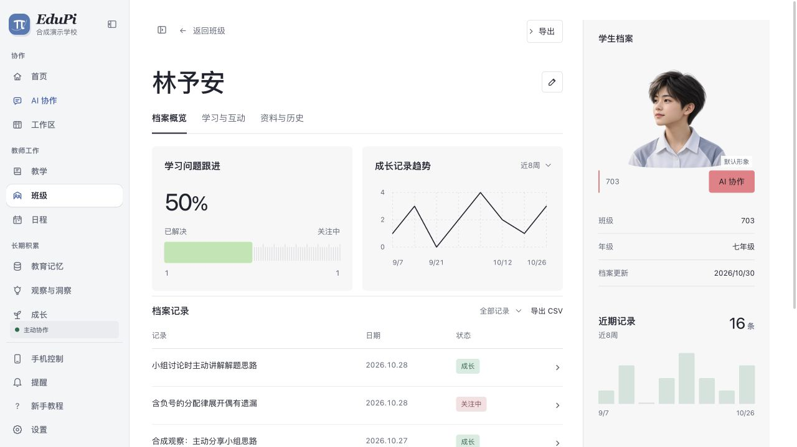

# 档案图表参考复刻

R12／R17本轮代码为 `1b95d923f23a4881526d3d9ca3f97aa2d265aed0`。按用户新的档案参考图重做主视图：双图表、紧凑记录表、人物侧栏，原有资料与历史仍可进入；替代前轮仅以时间线卡片作为概览的状态。状态为开发与视觉验收通过，未打包安装。

## 数据和交互

学生卡显示现有学习问题中已解决的比例，班级卡显示当前名单中已有档案内容的比例；趋势和右侧活动图统计档案成长记录。8周、6月、全部按真实日期重算，原始日期不改写；缺日期单独待核，零分母不显示假百分比，空记录不画假曲线。班级已解决问题单独进入完整记录表，不污染未解决的学习关注列表。

图表有曲线绘入、填充／柱增长、悬停读数和键盘读点；表格支持筛选、展开、分页和CSV下载。每次数据重渲染核对当前日期，跨午夜新增记录不再等到卸载才可见；切学生时表格按ID重新初始化筛选与展开。

## 证据

- Codex in-app browser实操：绘入offset`0.938439→0`、范围切换重算、键盘End读11月0条、鼠标悬停读10月10条；减少动态效果全部禁动画。320px文字、日期、状态与主要动作可见，表格无横向溢出；768／1024补查主区宽度。[观测](assets/2026-11-01-reference-dossier/observations.json)。
- 筛选已解决后，实际CSV下载只含该记录，展开可读原备注；切班703为1条、704为空。同名另一学生无记录时显示空态，筛选重置all。[悬停](assets/2026-11-01-reference-dossier/trend-hover.jpg)、[过渡帧](assets/2026-11-01-reference-dossier/trend-transition.jpg)、[窄屏记录表](assets/2026-11-01-reference-dossier/table-320.jpg)。
- 88项定向测试通过／0失败／0跳过，`tsc --noEmit`、目标ESLint、3份CSS解析和`git diff --check`通过。[验证摘要](assets/2026-11-01-reference-dossier/verification.json)。
- 已将原图和实现放入同一归一画布比较全视图及图表近景；修复右栏起点／遮挡、头像过大、表格密度及取证早于动画完成等问题。参考原图像素仅留本机忽略目录，不上传其患者内容；[设计QA](../../design-qa.md)记录精确裁剪与比较边界，最终passed。

默认人物和教室是通用生成插画，WebP与PNG回退均随源码提供，不代表真实学生照片或真实教室。预览使用12名合成学生及明确合成的演示轨迹，真实教师根、模型配置和正常App未操作；界面保存等API由独立代理模拟，不据此追认Core持久化通过。

## 预览与保留

供用户交互查看的本机地址为 `http://127.0.0.1:30147/?edupi=1&view=homeroom&student=synthetic-student-0`。30146为本轮Next服务，30147为仅回送合成API的代理，均只监听loopback；在用`.next`和隔离临时根保留到用户看完或取消后，停止服务、核对句柄再清理。[保留回执](assets/2026-11-01-reference-dossier/preview-retention.json)。测试CSV已精确清理，源码、插画、截图与在用依赖保留。另一任务的30144／`.95`浏览包服务未动。

当前预览tab暂时旁路旧Service Worker缓存；HTTP缓存与媒体／viewport模拟已恢复常态。没有执行不受支持的存储清空，没有改正式App缓存或系统外观。原图是静态图，不能证明其原始动画时序；本轮验证的是已实现的动效。未新建安装包或Release，现有公开包不包含本轮改版，原生安装、真实Core写入／恢复与自动升级仍待后续独立验收。
